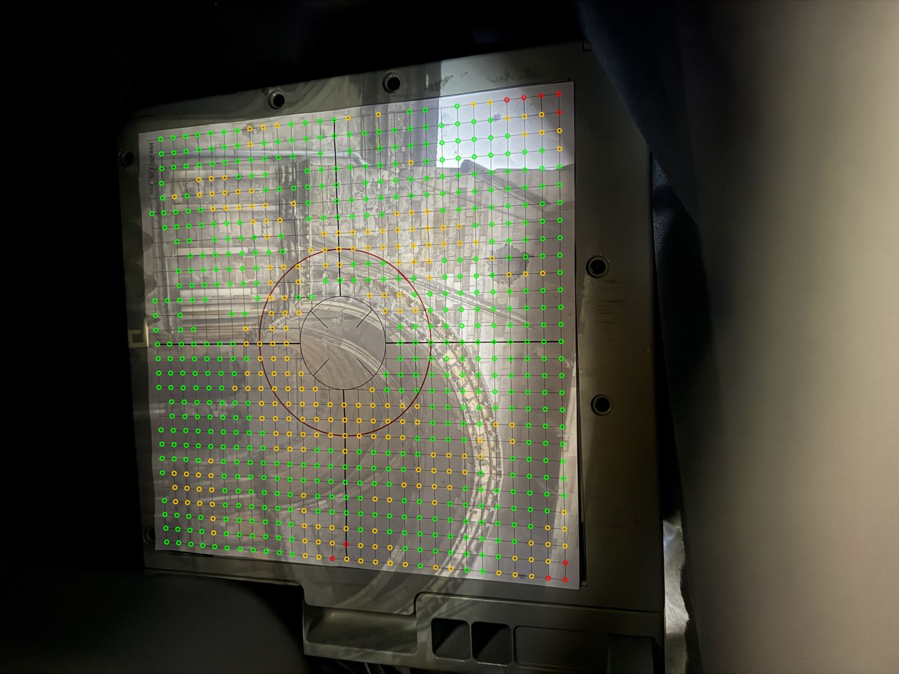
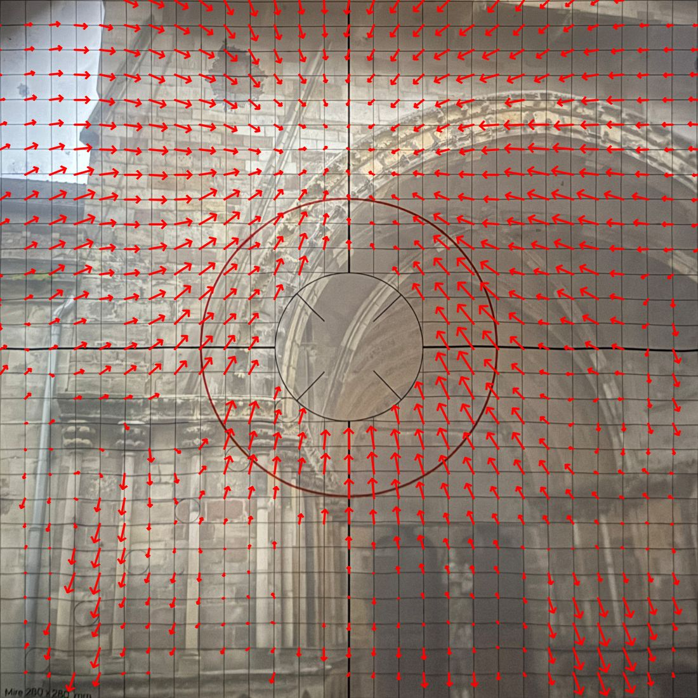
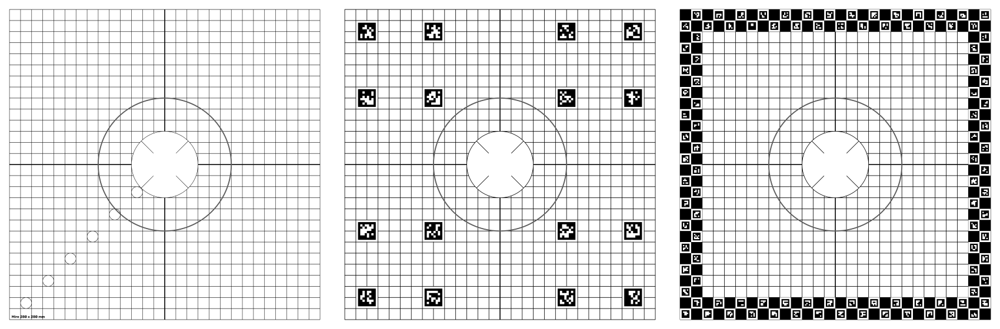
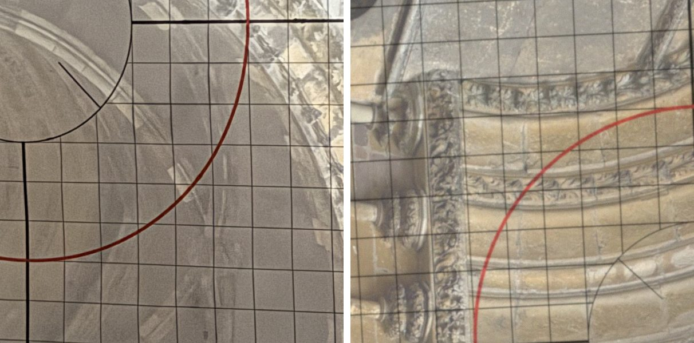
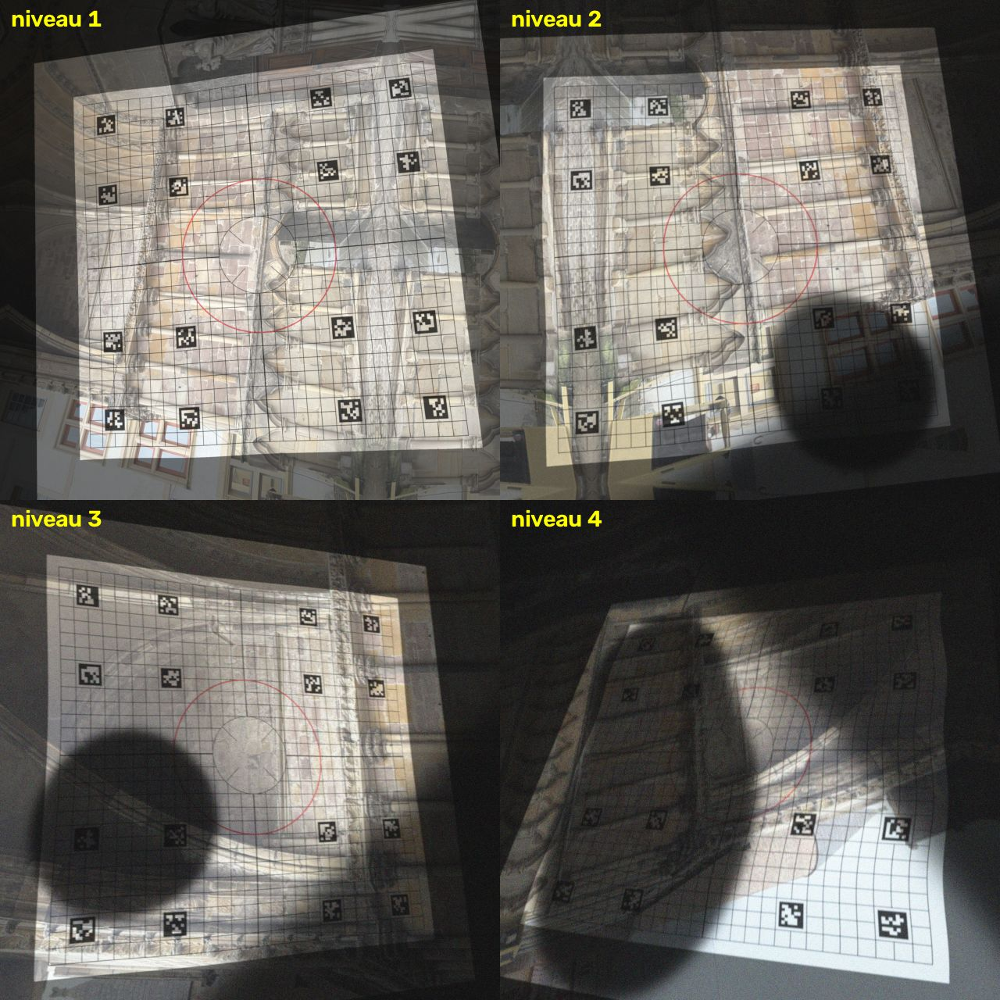
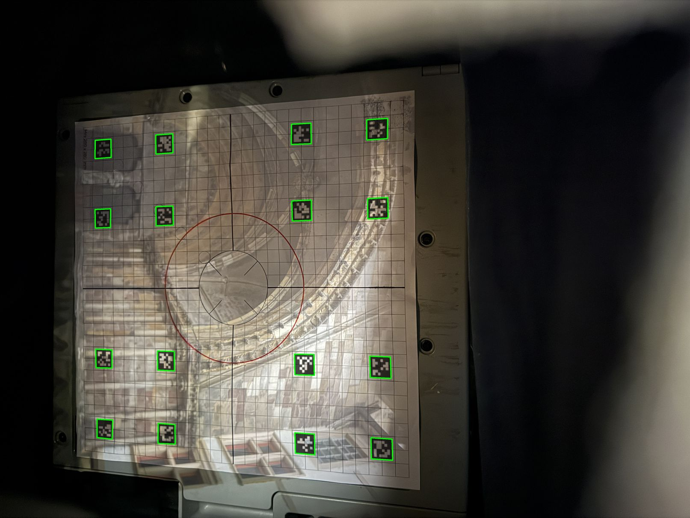
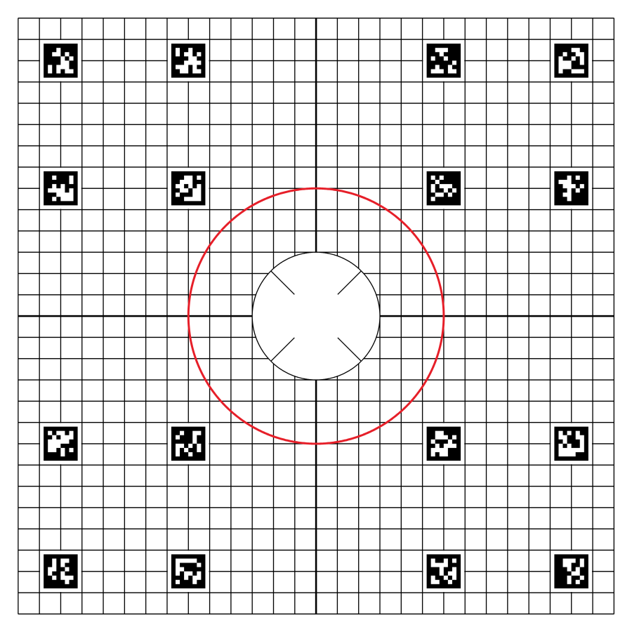

# Étude 2.1 — Détection de la mire

Tâche 2.1 du plan, 11 novembre 2026. Scripts et chiffres bruts :
`etudes/2.1-detection/` (voir son `LISEZMOI.md`).

## En bref

- **La mire actuelle se détecte déjà toute seule sur les 8 photos d'Épinal**
  (8 sur 8, 736 à 784 croisements mesurés sur 804), par le cercle rouge, la
  croix puis la grille. C'est la grille qui donne la précision.
- **Le redressement manuel d'Épinal laisse les croisements à 0,6 à 0,9 mm de
  leur place en moyenne, jusqu'à 1,9 mm.** La moitié de cet écart vient du
  papier qui gondole, que quatre coins ne peuvent pas rattraper.
- **Proposition : garder la grille, la croix et le cercle, épaissir les
  traits, ajouter 16 repères codés AprilTag répartis sur la feuille.** En
  simulation, cette mire est la seule qui reste détectée quand le centre de
  la feuille est sombre ou caché, et quand la photo est très en biais.
- **Précision attendue : moins de 0,1 mm sur une photo comme celles
  d'Épinal, 0,3 mm sur une mauvaise photo**, contre 0,4 à 1,4 mm avec un
  simple trapèze. Ces chiffres sortent d'une simulation ; ils restent à
  confirmer avec une mire imprimée (liste d'essais en fin de document).

## 1. Ce que montrent les vraies photos

Les 8 photos de `references/photos-brutes/` ont été ouvertes en pleine
résolution, puis mesurées (`photos_reelles.py`).

**Prise de vue.** iPhone 16 Pro, objectif principal (24 mm, f/1,78), pose de
1/9 à 1/5 s, 800 à 2 500 ISO, 4 032 × 3 024 px, orientation EXIF 8. La mire
occupe 1 790 à 1 950 px de côté (6,4 à 7,0 px par mm), et non 2 300 px comme
l'indique `jeu-essai/LISEZMOI.md`.

**La feuille.** Elle est plus grande que la mire : une marge blanche d'environ
8 mm entoure la grille (feuille d'environ 297 mm, un A3 recoupé). L'image de
la façade déborde sur cette marge et sur le plateau métallique du projecteur
(vis, bords, reflets). Une marge de 8 mm est trop étroite pour y loger des
repères : ils doivent aller dans la grille.

**Les traits.** Ils sont nets et bien visibles partout : 2,4 à 2,9 px de
large, 40 à 46 % plus sombres que le papier autour. Le fichier Illustrator
donne des traits de 0,1 mm ; à l'image ils se comportent comme des traits
d'environ 0,2 mm. La croix et le cercle rouge font 5 à 6 px.

**La lumière.** La façade a été photographiée de jour : le papier est éclairé
partout (gris de 73 à 105 sur 255 pour les zones les plus sombres, 185 à 204
pour les plus claires), presque rien n'est brûlé (0,4 % au plus, le ciel) et
rien n'est noir. Ces photos ne disent donc rien d'une façade de nuit, où des
pans entiers de l'image seraient noirs.

**L'image de façade par-dessus la grille.** Elle est plus douce que les
traits imprimés, mais elle a ses propres lignes : joints de pierre, colonnes,
arcs. Les arcs de pierre ocre forment de grandes ellipses colorées ; ma
première recherche du cercle rouge s'y est trompée sur plus de la moitié
des photos, avant réglage. On voit aussi, par transparence, les anneaux de la lentille du
projecteur, peu contrastés.

**Le papier gondole.** Les croisements s'écartent d'un trapèze parfait de
0,33 à 0,48 mm en moyenne, 0,67 à 0,94 mm au 95e centile, 1,3 à 2,1 mm au
maximum. L'écart varie doucement d'un bout à l'autre de la feuille (image
`reel-a-redressee-ecarts.jpg`) : c'est bien une ondulation, pas du bruit.

**Ce qui entre dans le cadre.** Sur la plupart des photos, une masse floue
(tissu, main, bord du projecteur) couvre un coin ou un bord de l'image ; elle
s'approche à une case de la grille sans la recouvrir. Les quatre coins du papier sont parfois dans
l'ombre du tissu.

**Le traitement de l'iPhone.** L'image est débruitée et accentuée (aspect
« aquarelle » dans les aplats). Le bruit visible est faible.

**Orientation.** La mire est couchée dans l'image. Les six petits cercles en
diagonale et le texte « Mire 280 × 280 mm » sont les seuls éléments qui
disent où est le bas.

**Anomalie du jeu d'essai.** `references/mire/mire-280.png` (et ses deux
réduits) n'est pas la mire : c'est une frise de seize fleurs. La vraie mire
est la page 2 de `mire-280.ai`, que l'étude a utilisée. À corriger hors de
cette tâche.

### Mesures sur les vraies photos

Détection de la mire actuelle (cercle rouge, croix, grille), sans aucune aide :

| Photo | Détectée | Croisements mesurés (sur 804) | Écart au trapèze, moy. / p95 / max (mm) | Erreur de prédiction d'un croisement mis de côté, moy. / p95 (mm) |
| --- | --- | --- | --- | --- |
| a-brut | oui | 749 | 0,40 / 0,82 / 1,45 | 0,12 / 0,29 |
| b-brut | oui | 784 | 0,45 / 0,94 / 1,25 | 0,15 / 0,33 |
| c-brut | oui | 759 | 0,48 / 0,87 / 2,06 | 0,11 / 0,24 |
| d-brut | oui | 736 | 0,33 / 0,67 / 2,00 | 0,09 / 0,21 |
| img_5293 | oui | 754 | 0,37 / 0,78 / 2,03 | 0,08 / 0,20 |
| img_5295 | oui | 772 | 0,34 / 0,72 / 2,09 | 0,09 / 0,21 |
| img_5298 | oui | 752 | 0,34 / 0,70 / 1,59 | 0,10 / 0,28 |
| img_5302 | oui | 772 | 0,37 / 0,84 / 1,40 | 0,11 / 0,30 |

La dernière colonne est la seule mesure de précision possible sans vérité
terrain : on retire un croisement sur quatre, on le prédit à partir des
autres, on compare. Elle majore l'erreur du redressement par la grille.
L'orientation est trouvée sans ambiguïté sur les 8 photos.

Redressement manuel (photos `photos-redressees/`, faites dans Millumin par 4
coins) : où tombent les croisements par rapport à leur place théorique ?

| Photo redressée | Écart moy. / p95 / max (mm) | Dont non rattrapable par 4 coins, moy. / p95 (mm) |
| --- | --- | --- |
| a | 0,61 / 1,04 / 1,31 | 0,40 / 0,85 |
| b | 0,89 / 1,56 / 1,92 | 0,46 / 0,94 |
| c | 0,87 / 1,55 / 1,74 | 0,46 / 0,92 |
| d | 0,60 / 1,41 / 1,55 | 0,32 / 0,66 |

Ordre de grandeur sur la façade : si un projecteur couvre 8 m de large, 1 mm
sur la diapositive vaut 2,9 cm. Le redressement manuel expliquerait alors 2
à 5 cm de l'écart de 5 à 10 cm constaté. La largeur couverte à Épinal ne
figure pas dans le jeu d'essai : ce calcul est une hypothèse.

**Ce que je n'ai pas pu mesurer** : l'erreur absolue (aucune vérité terrain
sur ces photos) ; ce que la position de la plaque et la mise au point
ajoutent ; le comportement de nuit ; d'autres chantiers que celui d'Épinal.

## 2. Candidats

| | Dessin | Comment on la trouve | Points précis |
| --- | --- | --- | --- |
| **A** | Mire actuelle, traits de 0,2 mm (largeur apparente mesurée) | Cercle rouge, puis croix, puis petits cercles pour l'orientation | Croisements de la grille (804) |
| **A+** | La même, traits de 0,35 mm | Idem | Idem |
| **B** | Grille 0,35 mm + 16 repères codés AprilTag 36h11 de 16 mm, chacun dans un bloc de 2 × 2 cases, répartis en 4 × 4 | Chaque repère porte son numéro et son sens | Croisements (660), amorcés par les repères |
| **C** | Grille 0,35 mm + couronne de damier ChArUco large de 20 mm (cases de 10 mm, codes de 7 mm) | Codes de la couronne | Points de selle de la couronne (104), puis croisements (492) |

Pour B et C, j'ai aussi mesuré ce que donnent les repères **seuls**, sans la
grille : c'est le cas « repères aux quatre coins » poussé à 16 repères.

Idées écartées sans les simuler : une grille de points ou de cercles pleins
(un point se confond avec une pierre sombre, et sans code il faut voir toute
la grille pour savoir quel point est lequel) ; un damier couvrant toute la
feuille (il cache la moitié de l'image de façade).

**Étape commune à tous les candidats.** À partir d'une position approchée, on
mesure chaque croisement : on moyenne l'image le long de chaque trait sur
8 mm, on cherche le creux, au dixième de pixel. On avance de proche en
proche, chaque croisement mesuré aidant à prédire ses voisins. On écarte les
mesures incohérentes, puis on ajuste un trapèze et une correction locale
lissée. Une zone sans croisement mesurable reste « non couverte » : c'est la
carte de confiance demandée par la tâche 2.4.

## 3. Protocole

**Simulateur** (`simulateur.py`). Photo de 2 600 px, mire à 6,7 px par mm.
L'encre absorbe la lumière de l'image de façade (multiplication en lumière
linéaire). S'y ajoutent : biais de prise de vue, rotation quelconque, papier
qui gondole (ondulation lisse, le trait glisse par rapport à l'image),
distorsion d'objectif, flou de mise au point, flou de bougé, bruit,
vignettage, zones sombres de la façade, masse floue devant l'objectif,
compression JPEG. La vérité terrain est exacte.

L'image de façade vient des photos directes du portail (`x-mur`), et non des
photos redressées comme le suggérait la consigne : celles-ci contiennent déjà
l'ancienne grille, ce qui aurait faussé la comparaison.

**Ressemblance avec le réel.** Niveau 1 réglé sur Épinal : contraste des
traits 0,36 (réel 0,40 à 0,46), largeur 3,1 px (réel 2,4 à 2,9), écart au
trapèze 0,40 mm (réel 0,33 à 0,48). À l'œil, c'est ressemblant sans être
confondable : l'image de façade simulée est plus nette, plus colorée et plus
contrastée que la vraie (donc plus gênante) ; le grain « aquarelle » de
l'iPhone, les reflets du plateau et les anneaux de la lentille manquent.

**Niveaux de difficulté** (30 scènes chacun, les mêmes pour tous les candidats) :

| Niveau | Biais | Gondolage max | Flou (px) | Bougé (px) | Bruit | Part sombre | Part cachée |
| --- | --- | --- | --- | --- | --- | --- | --- |
| 1 — comme Épinal | 3 à 12° | 0,6 à 1,5 mm | 0,8 à 1,1 | 0 à 1,5 | 1 à 2 % | 0 | 0 |
| 2 — photo médiocre | 10 à 20° | 1,5 à 2,5 mm | 1,2 à 1,6 | 2 à 4 | 3 à 5 % | 10 à 20 % | 3 à 8 % |
| 3 — mauvaise photo | 18 à 28° | 2,5 à 3,5 mm | 1,6 à 2,2 | 4 à 7 | 5 à 8 % | 20 à 30 % | 8 à 15 % |
| 4 — photo ratée | 28 à 38° | 3,5 à 4,5 mm | 2,2 à 3,0 | 7 à 11 | 8 à 12 % | 35 à 45 % | 15 à 25 % |

S'y ajoutent des **balayages** : un seul défaut poussé à la fois, tout le
reste au niveau 1, 10 scènes par valeur. En tout 440 scènes × 4 candidats.
Le détecteur prototype met 0,8 s par photo.

**Mesure.** L'erreur est la distance, en mm sur la mire, entre la vraie
position d'un point et celle que donne le résultat de la détection. Elle est
prise au centre des 784 cases, jamais sur un croisement. Vocabulaire des
tableaux :

- *juste* : détectée, erreur au 95e centile ≤ 0,5 mm dans la zone couverte ;
- *médiocre* : entre 0,5 et 2 mm ;
- *fausse* : plus de 2 mm, sans que le détecteur le sache (grille décalée
  d'une case, mire tournée d'un quart de tour) ;
- *couverture* : part de la mire à moins de 8 mm d'un croisement mesuré.

## 4. Résultats

### Vue d'ensemble

Sur les 440 scènes, toutes conditions confondues : B est juste 378 fois, C
340 fois, A+ 293 fois, A 286 fois. A et A+ donnent 9 résultats faux chacune,
B et C aucun.

### Par niveau

| Niveau | Candidat | Détectées | Justes | Médiocres | Fausses | Points fiables | Couverture | Erreur moy. (mm) | Erreur p95 (mm) | Trapèze seul, moy. / p95 (mm) |
| --- | --- | --- | --- | --- | --- | --- | --- | --- | --- | --- |
| 1 | A | 30/30 | 30/30 | 0 | 0 | 748 | 97 % | 0,04 | 0,07 | 0,40 / 0,76 |
| 1 | A+ | 30/30 | 30/30 | 0 | 0 | 784 | 97 % | 0,04 | 0,07 | 0,40 / 0,76 |
| 1 | B | 30/30 | 30/30 | 0 | 0 | 644 | 89 % | 0,03 | 0,07 | 0,40 / 0,75 |
| 1 | C | 30/30 | 30/30 | 0 | 0 | 485 | 70 % | 0,04 | 0,08 | 0,43 / 0,95 |
| 2 | A | 30/30 | 30/30 | 0 | 0 | 584 | 91 % | 0,09 | 0,17 | 0,90 / 1,68 |
| 2 | A+ | 29/30 | 29/30 | 0 | 0 | 692 | 96 % | 0,09 | 0,17 | 0,88 / 1,64 |
| 2 | B | 30/30 | 30/30 | 0 | 0 | 572 | 87 % | 0,09 | 0,17 | 0,90 / 1,65 |
| 2 | C | 30/30 | 30/30 | 0 | 0 | 442 | 70 % | 0,09 | 0,17 | 0,96 / 1,87 |
| 3 | A | 11/30 | 10/30 | 0 | 1 | 264 | 59 % | 0,12 | 0,27 | 1,32 / 2,75 |
| 3 | A+ | 11/30 | 11/30 | 0 | 0 | 398 | 70 % | 0,14 | 0,28 | 1,34 / 2,71 |
| 3 | B | 30/30 | 27/30 | 3 | 0 | 325 | 62 % | 0,12 | 0,28 | 1,38 / 2,74 |
| 3 | C | 24/30 | 21/30 | 3 | 0 | 266 | 53 % | 0,13 | 0,27 | 1,42 / 3,04 |
| 4 | A | 1/30 | 1/30 | 0 | 0 | 43 | 13 % | 0,17 | 0,33 | 5,34 / 11,64 |
| 4 | A+ | 1/30 | 1/30 | 0 | 0 | 89 | 24 % | 0,13 | 0,28 | 3,33 / 9,95 |
| 4 | B | 21/30 | 15/30 | 6 | 0 | 72 | 19 % | 0,11 | 0,27 | 3,50 / 8,81 |
| 4 | C | 1/30 | 1/30 | 0 | 0 | 79 | 20 % | 0,21 | 0,40 | 3,62 / 8,95 |

Les colonnes « points », « couverture » et « erreur » sont des médianes sur
les photos justes ; l'erreur est mesurée dans la zone couverte. Les
détections « médiocres » de B et C ont une erreur de 0,5 à 0,7 mm, sans aucun
croisement mal placé : c'est la correction locale qui ne suit plus un papier
très gondolé là où les points sont rares.

### Les repères seuls, sans la grille

| Niveau | Candidat | Photos où un repère est lu | Points d'appui | Trapèze, moy. / p95 (mm) | Correction lissée, moy. / p95 (mm) |
| --- | --- | --- | --- | --- | --- |
| 1 | B | 30/30 | 64 | 0,43 / 0,88 | 0,27 / 0,58 |
| 1 | C | 30/30 | 97 | 0,46 / 0,94 | 0,36 / 0,88 |
| 2 | B | 30/30 | 60 | 0,93 / 1,87 | 0,57 / 1,53 |
| 2 | C | 30/30 | 54 | 1,04 / 2,06 | 0,86 / 1,99 |
| 3 | B | 30/30 | 44 | 1,58 / 3,14 | 1,28 / 3,18 |
| 3 | C | 27/30 | 12 | 4,36 / 11,37 | 3,18 / 7,32 |
| 4 | B | 30/30 | 24 | 3,23 / 7,25 | 2,75 / 7,15 |
| 4 | C | 3/30 | 7 | — | — |

Les repères codés sont lus sur toutes les photos, même ratées. Mais seuls,
ils sont bien moins précis que la grille : un coin de repère est
mesuré à 0,15 mm près (niveau 1) ou 0,5 mm (niveau 4), un croisement à 0,01
à 0,06 mm, et 16 repères ne suffisent pas à suivre le papier.

### Un seul défaut à la fois

Chaque case : photos justes sur 10, puis erreur p95 médiane (mm).

| Défaut | Valeur | A | A+ | B | C |
| --- | --- | --- | --- | --- | --- |
| Flou de mise au point (px) | 2 | 10 · 0,11 | 10 · 0,11 | 10 · 0,11 | 10 · 0,11 |
| | 3 | 10 · 0,12 | 10 · 0,11 | 10 · 0,11 | 5 · 0,11 |
| | 4,5 | 2 · 0,20 | 9 · 0,17 | 10 · 0,18 | 0 |
| | 6 | 0 | 0 | 0 | 0 |
| Bougé (px) | 4 | 10 · 0,10 | 10 · 0,10 | 10 · 0,11 | 10 · 0,12 |
| | 8 | 10 · 0,22 | 10 · 0,18 | 10 · 0,20 | 8 · 0,20 |
| | 14 | 0 (4 médiocres) | 1 (6 médiocres) | 1 (7 médiocres) | 0 |
| | 20 | 0 | 0 | 0 | 0 |
| Bruit (% au gris moyen) | 5 | 10 · 0,11 | 10 · 0,11 | 10 · 0,11 | 10 · 0,11 |
| | 10 | 9 · 0,08 | 9 · 0,08 | 10 · 0,11 | 10 · 0,12 |
| | 20 | 4 · 0,11 | 4 · 0,10 | 10 · 0,10 | 10 · 0,10 |
| | 30 | 0 | 0 | 10 · 0,09 | 10 · 0,09 |
| Biais (degrés) | 25 | 10 · 0,10 | 10 · 0,12 | 10 · 0,10 | 10 · 0,11 |
| | 40 | 8 · 0,14 | 6 · 0,16 (2 fausses) | 10 · 0,10 | 10 · 0,10 |
| | 50 | 6 · 0,20 (2 fausses) | 7 · 0,22 (1 fausse) | 10 · 0,09 | 10 · 0,10 |
| Part de la feuille dans le noir | 25 % | 10 · 0,10 | 10 · 0,10 | 10 · 0,10 | 10 · 0,10 |
| | 50 % | 4 · 0,06 | 5 · 0,07 | 10 · 0,11 | 10 · 0,12 |
| | 70 % | 1 · 0,19 | 0 | 10 · 0,12 | 10 · 0,12 |
| | 85 % | 0 | 0 | 10 · 0,10 | 10 · 0,11 |
| Part cachée par un objet noir | 15 % | 10 · 0,08 | 10 · 0,08 | 10 · 0,08 | 10 · 0,08 |
| | 30 % | 10 · 0,11 | 10 · 0,11 | 10 · 0,11 | 10 · 0,11 |
| | 50 % | 9 · 0,07 | 9 · 0,07 | 10 · 0,07 | 10 · 0,07 |
| Gondolage max (mm) | 3 | 9 · 0,22 | 9 · 0,21 | 9 · 0,21 | 9 · 0,22 |
| | 5 | 2 (4 médiocres, 3 fausses) | 2 (5 médiocres, 2 fausses) | 5 (5 médiocres) | 5 (5 médiocres) |
| | 8 | 1 (2 médiocres, 3 fausses) | 1 (1 médiocre, 4 fausses) | 1 (9 médiocres) | 1 (9 médiocres) |

Les lignes « dans le noir » et « cachée » sont celles où la zone ne garde
que 0,3 % de lumière. Avec 5 à 7 % de lumière restante et le bruit du
niveau 1, aucun candidat n'est gêné (10 sur 10 partout) : ces lignes sont
dans `resultats/tableaux.md`.

### Ce qui casse en premier

- **A, mire actuelle.** Elle tient tant que le cercle rouge et la croix sont
  visibles. Elle casse dès que le centre est dans le noir (4 sur 10 à 50 %),
  avec le bruit (4 sur 10 à 20 %) et le fort biais. Surtout, elle peut se
  tromper **sans le savoir** : 9 détections fausses sur les 440 scènes pour
  A, 9 pour A+ (biais de 40° et plus, papier très gondolé, niveau 3),
  aucune pour B ni C. Chaque fois, la grille est décalée d'une case entière
  (10 mm). Causes d'échec : croix introuvable (48), cercle
  introuvable (38), trop peu de croisements (32), orientation incertaine
  (15).
- **A+, traits épais.** Même amorce, mêmes limites. Le trait épais apporte
  des croisements en plus dans les mauvaises photos (398 contre 264 au
  niveau 3) et tient mieux au flou (9 sur 10 contre 2 sur 10 à 4,5 px).
- **B, repères codés.** Les repères sont lus partout ; ce qui lâche, c'est la
  grille, quand flou et bougé effacent les traits (niveau 4 : 21 détectées
  sur 30, couverture de 19 %). Causes d'échec : trop peu de croisements
  (25), aucun repère lu (4, toutes avec un bougé de 20 px).
- **C, couronne ChArUco.** Ses petits codes de 7 mm cèdent au flou bien
  avant la grille : 5 sur 10 à 3 px de flou, 0 à 4,5 px, 1 sur 30 au
  niveau 4. Elle couvre aussi moins (70 % : rien n'est mesuré dans la
  couronne) et masque le bord de l'image de façade.
- **Pour tous** : au-delà de 4,5 px de flou ou de 14 px de bougé, il n'y a
  plus rien à mesurer ; au-delà de 5 mm de gondolage, la correction ne suit
  plus. À 14 px de bougé, le résultat devient médiocre sans que le détecteur
  s'en aperçoive : il faudra un indicateur de netteté qui refuse la photo.

### Essai sur de vraies photos avec des repères incrustés

Faute de mire imprimée, j'ai incrusté les 16 repères de la mire B dans les 8
vraies photos, à leur place, comme une encre (`reperes_sur_reel.py`). Le
bruit, le traitement de l'iPhone, l'image de façade et l'ondulation sont
réels ; seule l'encre des repères est simulée. **Les 16 repères sont relus
sur les 8 photos**, par OpenCV comme par le détecteur en Rust, avec des coins
à 0,19 à 0,25 mm de leur place (médiane).

## 5. Recommandation

### La mire proposée

C'est le candidat B.

- Grille de 10 mm, croix centrale, cercle rouge, disque central : conservés.
  La mire reste lisible à l'œil, et l'ancienne méthode (cercle + croix) reste
  un secours.
- Traits fins de 0,35 mm au lieu de 0,1 mm.
- 16 repères AprilTag 36h11, numéros 0 à 15, de 16 mm de côté (modules de
  2 mm), chacun centré dans un bloc de 20 mm vidé de ses traits. Blocs aux
  abscisses et ordonnées 10, 70, 190 et 250 mm : 12 en couronne, 4 plus près
  du centre, aucun sur la croix ni sur le cercle. Ils couvrent 8 % de la
  surface.
- Les six petits cercles et le texte ne servent plus à l'orientation : le
  générateur (tâche 2.2) peut les garder ou non. Le numéro des repères peut
  servir d'identifiant de version de mire.

### La méthode

1. **Amorce.** Lire les repères codés, en trois passes de plus en plus
   floutées. Sans repère (ancienne mire) : cercle rouge, croix, petits
   cercles. En dernier recours : quatre coins cliqués à la main (tâche 2.5).
2. **Grille.** Mesurer les croisements de proche en proche à partir de
   l'amorce.
3. **Contrôle.** Écarter les mesures incohérentes ; refuser la photo si elle
   est trop floue ou si trop peu de croisements sont mesurés.
4. **Modèle.** Trapèze + correction locale lissée. Le moteur a déjà ces
   fonctions (tâche 2.3 : `Homography::fit`, spline lissée, écarts). Le
   prototype lisse par régression locale ; la tâche 2.4 devra vérifier, sur
   les 8 vraies photos, que la spline du moteur fait au moins aussi bien. Sorties : image redressée, écart résiduel, carte de couverture,
   cause en clair en cas d'échec.

Les coins des repères ne servent qu'à l'amorce.

### L'écriture en Rust

Aucune dépendance à OpenCV n'est nécessaire.

| Partie | Comment | Difficulté |
| --- | --- | --- |
| Mesure des croisements, propagation, contrôle, modèle | À écrire. Le prototype (`mesurer_noeuds`, `croissance`, `nettoyer`, `Modele`) n'utilise que des moyennes, des filtres à une dimension et des systèmes 3 × 3 ; environ 500 à 700 lignes de Rust. Vérifiable tout de suite sur les 8 vraies photos | Moyenne |
| Lecture des repères codés | Crate `kornia-apriltag` 0.2.0 (voir ci-dessous) | Faible si la crate convient, forte sinon |
| Amorce cercle rouge + croix (ancienne mire) | À écrire : seuil sur le rouge, ajustement d'ellipse par tirages, deux droites ; environ 300 lignes | Moyenne |
| Lecture des images | Crate `image` 0.25 (MIT ou Apache-2.0), déjà utilisée par les tests du moteur. Le HEIC relève de la tâche 2.5 | Faible |

**Crates vérifiées** le 12 novembre 2026 par `cargo search` et `cargo info`
(la page crates.io n'était pas consultable depuis la session : je n'ai ni les
dates de publication ni le nombre de téléchargements).

| Crate | Version | Licence | Ce que j'ai vérifié |
| --- | --- | --- | --- |
| `kornia-apriltag` | 0.2.0 | Apache-2.0 | **Essayée** (`essai-rust/`). Se compile sous Linux avec Rust 1.97 en 4 min 40 sur un cœur. Réécriture de l'algorithme AprilTag en Rust ; demande Rust 1.89 ; tire 181 crates, dont deux qui compilent un peu de C (`generator`, `psm`) |
| `apriltag` | 0.4.0 | BSD-2-Clause | Existe. Simple pont vers la bibliothèque C d'origine : pas du Rust pur. Non essayée |
| `aprilgrid` | 0.8.0 | MIT ou Apache-2.0 | Existe, Rust pur. Conçue pour les planches « AprilGrid » (repères jointifs avec points de selle). Non essayée |
| `locus-core` | 0.11.0 | MIT ou Apache-2.0 | Existe. Non essayée |
| `calib-targets-aruco`, `calib-targets-charuco` | 0.16.1 | MIT ou Apache-2.0 | Existent (ArUco, ChArUco). Non essayées |
| `imageproc` | 0.27.0 | MIT | Existe. Pas nécessaire |
| `nalgebra` | 0.35.0 | Apache-2.0 | Existe. Pas nécessaire : la tâche 2.3, fusionnée entre-temps, a écrit son propre calcul (trapèze, spline lissée, écarts) |

**Essai de `kornia-apriltag`** sur 40 photos simulées de la mire B, face à
OpenCV (repères lus sur 16, en moyenne) :

| Niveau | OpenCV, 3 passes | Rust, 1 passe (réglages d'origine) | Rust, 3 passes | Coin, médiane (mm), Rust 3 passes |
| --- | --- | --- | --- | --- |
| 1 | 16,0 | 14,4 | 16,0 | 0,17 |
| 2 | 13,6 | 7,2 | 15,9 | 0,24 |
| 3 | 11,9 | 2,0 | 14,5 | 0,33 |
| 4 | 5,6 | 0,0 | 7,7 | 0,39 |

Aucun faux repère, ni d'un côté ni de l'autre. Avec ses réglages d'origine,
la crate décroche vite ; avec trois passes (flou de 0, 1,5 et 3 px, image
réduite 2, 3 et 4 fois) elle fait mieux qu'OpenCV, en 0,2 s par photo.

**Réserves.** La crate est jeune et lourde ; je ne l'ai pas compilée sur Mac.
Si elle gêne la fabrication de l'app, le repli est d'écrire un lecteur limité
à nos 16 repères (seuil local, contours à quatre côtés, lecture de 36 cases,
correction de 2 erreurs) : 600 à 800 lignes, difficile, deux sessions.

### Conséquences pour le plan

Je n'ai pas modifié `docs/plan.md`. Voici ce que l'étude suggère d'y changer.

- **Tâche 2.2.** Le générateur dessine la mire B décrite ci-dessus. Critère à
  ajouter : « les 16 repères sont relus sur une photo de la mire imprimée ».
- **Tâche 2.4.** Le critère « superposable à A.tiff à moins de 0,5 mm » ne
  peut pas être tenu : A.tiff s'écarte lui-même de la grille de 0,6 mm en
  moyenne et 1,3 mm au plus. Critère proposé : « sur les 8 photos d'Épinal,
  les croisements de l'image redressée tombent à moins de 0,3 mm de leur
  place (95e centile), et la détection réussit sans aide ».
- **Tâche 2.4, découpage.** Deux morceaux : *2.4a* grille et amorce par le
  cercle rouge, testable dès maintenant sur les vraies photos ; *2.4b*
  repères codés, à lancer quand une photo de la nouvelle mire existe.
- **Tâche 2.5.** Les quatre coins posés à la main deviennent une amorce : la
  grille affine ensuite, même en mode manuel.
- **Jeu d'essai.** Remplacer `mire-280.png` par la vraie mire ; corriger
  « 2 300 px » dans `jeu-essai/LISEZMOI.md` ; ajouter des photos de la
  nouvelle mire dès qu'elles existent.

## 6. Limites, et ce qui reste à valider sur site

### Ce que la simulation ne prouve pas

- **L'encre et le papier réels.** Le noir d'une imprimante de bureau, la
  transparence du papier, les aplats de 16 mm qui font gondoler la feuille :
  rien de cela n'est simulé.
- **Le noir.** Dans la simulation, une zone « noire » garde un signal
  exploitable parce que le bruit y est faible. Un iPhone écrase et lisse les
  ombres : la couverture annoncée dans les zones sombres est optimiste.
- **La nuit.** Les photos d'Épinal montrent une façade de jour. Je ne sais
  pas à quel point une façade de nuit laisse des pans de papier noirs.
- **Le traitement de l'iPhone** (débruitage, accentuation, mode nuit, HEIC,
  48 Mpx) n'est couvert que par l'essai d'incrustation.
- **Les plis.** Le gondolage simulé est une ondulation lisse. Un pli franc
  ou un coin corné n'est pas simulé.
- **Les reflets** sur une pochette plastique ou un papier brillant.
- **La gêne pour l'œil.** Seize carrés noirs de 16 mm cachent 8 % de l'image
  de façade : acceptable ou non, c'est à Benjamin et Marc de le dire.
- **La précision annoncée** vaut pour la position des traits de la mire dans
  la photo. Elle ne dit rien de la position de la plaque dans le projecteur
  ni de la mise au point, qui restent mécaniques.
- **Un seul chantier.** Les 8 vraies photos viennent du même site, du même
  téléphone, de la même main.

### Essais à faire avec une mire imprimée

1. **Impression.** Imprimer la mire B à 100 % sur l'imprimante habituelle.
   Mesurer à la règle : 280 mm dans les deux sens (à 0,3 mm près), un repère
   de 16 mm. Regarder si les aplats noirs font gondoler le papier.
2. **Atelier, conditions normales.** Poser la mire sur un rétroprojecteur
   pointé vers un mur éclairé, sous le tissu. Trois photos comme à Épinal
   (objectif 1x). Attendu : 16 repères lus, plus de 600 croisements.
3. **Atelier, photos volontairement mauvaises.** Une photo très en biais
   (30° ou plus), une légèrement bougée, une avec un coin caché par le
   tissu, une prise de loin (mire sur la moitié de l'image), une où la mire
   est tournée d'un quart de tour. Attendu : au moins un repère lu sur
   chacune.
4. **De nuit, sur une vraie façade.** Trois photos par projecteur. Noter
   combien de repères tombent dans une zone noire de l'image, et s'ils sont
   lus.
5. **Papier.** Refaire l'essai 2 avec deux papiers (80 g ordinaire, 160 g
   mat) : lequel gondole le moins, lequel laisse le mieux voir l'image ?
6. **Lisibilité.** Dire si les traits de 0,35 mm et les 16 carrés gênent la
   lecture de l'image de façade à l'œil.
7. **Répétabilité.** Deux photos de la même mire, sans la bouger, téléphone
   tenu différemment. Les deux images redressées doivent se superposer à
   moins de 0,2 mm : c'est la meilleure mesure de précision possible sur
   site.
8. **Ancienne mire, autres chantiers.** Envoyer une dizaine de photos de
   mire d'autres projets : la détection par le cercle rouge tient-elle
   ailleurs qu'à Épinal ?
9. **Formats.** Une photo en HEIC et une en 48 Mpx, pour la tâche 2.5.
